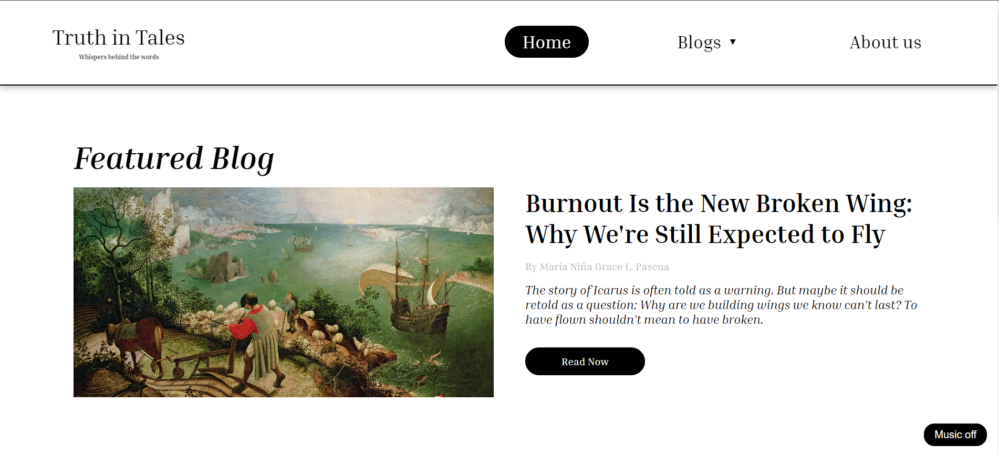

# Truth in Tales – Creative Writing Website

[](https://developer.mozilla.org/en-US/docs/Web/HTML)
[](https://developer.mozilla.org/en-US/docs/Web/CSS)
[](https://developer.mozilla.org/en-US/docs/Web/JavaScript)
[](https://pages.github.com/)

> **Truth in Tales** is a creative writing website where stories, reflections, and everyday thoughts come to life. It provides a space for readers to explore personal experiences, meaningful narratives, and perspectives through a simple, accessible, and reader-focused design.



---

## Overview

**Truth in Tales** is a static website dedicated to showcasing creative writing, personal essays, and reflections. The platform emphasizes readability, accessibility, and a visually organized interface, allowing visitors to focus on the content and the stories being shared.

The website consists of three main sections:

- **Home / Landing Page** – Introduces the website and its purpose.
- **Blog / Essays** – Displays creative writing pieces, personal reflections, and stories.
- **About Us** – Provides information about the website and the team behind its development.

---

## Tech Stack

- **HTML5** – Structures the website's content and pages.
- **CSS3** – Handles styling, layouts, and responsive design.
- **JavaScript** – Supports client-side interactive elements.
- **GitHub Pages** – Provides static website hosting and deployment.

---

## Features

- **Clean and Minimalist Interface** – A reader-focused layout that emphasizes simplicity and visual clarity.
- **Responsive Web Design** – Layouts designed to adapt to desktop, tablet, and mobile screens.
- **Creative Writing Collection** – Organized presentation of essays, personal reflections, and literary content.
- **Readable Typography** – Thoughtful use of typography, spacing, and contrast to improve readability.
- **Lightweight Architecture** – A static website that does not require a backend server.
- **Easy Navigation** – Organized sections that allow users to explore content conveniently.

---

## Team

Truth in Tales was developed collaboratively by six team members, with responsibilities divided between interface design and development.

| Name | Role |
|---|---|
| Francine Angela G. Alejandro | UI / Frontend Designer |
| Yohanna A. Decilio | UI / Frontend Designer |
| Shane S. Mendoza | UI / Frontend Designer |
| Maria Niña Grace L. Pascua | UI / Frontend Designer |
| Mark Harold T. Valderrama | Backend / Developer |
| Randel Angelo L. Yumul | Backend / Developer |

**UI / Frontend Team:** Responsible for layout design, typography, visual consistency, and user experience.

**Development Team:** Responsible for website functionality, site structure, technical implementation, and deployment.

---

## Getting Started

### Prerequisites

- A modern web browser such as Google Chrome, Mozilla Firefox, Microsoft Edge, or Safari.
- Git (optional, for cloning the repository).

### Running Locally

1. Clone the repository:

```bash
git clone https://github.com/RandelYumul/Truth_in_Tales.git
cd Truth_in_Tales
```

2. Open the website's HTML files in your preferred browser.

3. Navigate through the Home, Blog/Essays, and About Us sections to explore the website.

---

## Project Structure

```text
Truth_in_Tales/
├── .github/
│   └── workflows/         # GitHub Actions workflows
├── assets/                # Images, icons, and visual assets
├── audio/                 # Audio resources
├── css/                   # Stylesheets
├── js/                    # JavaScript files
├── pages/                 # Additional HTML pages
├── index.html             # Main landing page
└── README.md              # Project documentation
```

---

## Deployment

Truth in Tales is deployed using **GitHub Pages**, allowing the website to be accessed online without requiring a backend server.

**Live Website:** [Truth in Tales](https://randelyumul.github.io/Truth_in_Tales/)

**Repository:** [GitHub – Truth in Tales](https://github.com/RandelYumul/Truth_in_Tales)

---

## Contact

For inquiries or information regarding the project, please contact:

- **GitHub:** [RandelYumul](https://github.com/RandelYumul)
- **Email:** [randel.angelo10@gmail.com](mailto:randel.angelo10@gmail.com)

---

*Developed collaboratively using HTML, CSS, and JavaScript. Hosted on GitHub Pages.*
